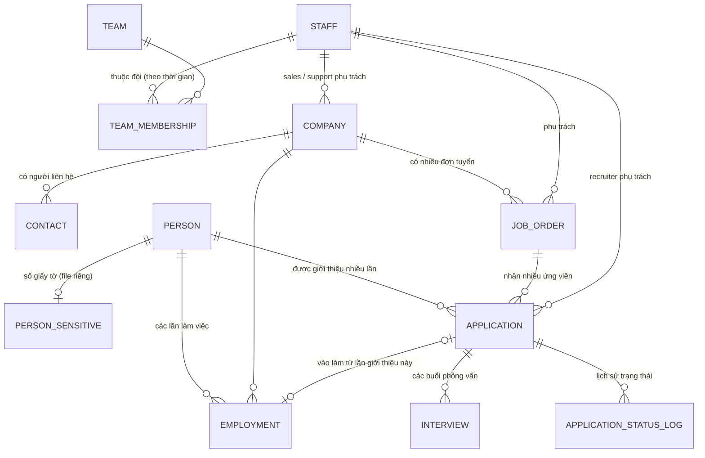

# DATA_MODEL.md — ERD lõi (bước 0.3)

> **[ĐÃ DUYỆT]** ERD lõi được duyệt ngày 2026-10-19 (D-030). Mọi thay đổi sau này phải nêu tác động và chờ duyệt.
> Phạm vi: các bảng lõi cho giai đoạn 1–4. Visa, phí, doanh số, hóa đơn sẽ thiết kế ở bước riêng.

## 1. Nơi lưu

| File | Nội dung | Chia sẻ |
|---|---|---|
| `HR_DATA` (Sheets) | Toàn bộ bảng nghiệp vụ dưới đây, mỗi bảng 1 tab | Không chia sẻ |
| `HR_SENSITIVE` (Sheets) | Số hộ chiếu, số 在留カード | Không chia sẻ; app chỉ đọc khi cần |
| Thư mục Drive `HR_FILES` | File giấy tờ, ảnh, 履歴書 | Không chia sẻ |
| Bản `_TEST` của cả 3 | Dữ liệu giả cho môi trường thử nghiệm | Không chia sẻ |

## 2. Sơ đồ quan hệ

Ngoài ra: `FILE` (gắn vào bất kỳ đối tượng nào) và `AUDIT_LOG` (nhật ký mọi thay đổi).

## 3. Các bảng (chỉ trường khóa và trường quyết định logic)

Trường chi tiết (địa chỉ, lương, tiếng Nhật, chứng chỉ…) sẽ hỏi ở giai đoạn 2 và 3.

Quy ước chung cho mọi bảng: `id` (UUID, không đổi), `ma` (mã hiển thị, ví dụ `CO-0001`), `tao_luc`, `tao_boi`, `sua_luc`, `sua_boi`, `da_an` (thay cho xóa cứng; `Y` = đã ẩn, trống = đang hiện).

Phiên bản cấu trúc: **18** (2: bước 2.1; 3: bước 2.2; 4: bước 2.3; 5: bước 3.1; 6: bước 3.2; 7: bước 3.3; 8: bước 3.4; 9: bước 4.3 — thêm tab SETTING; 10: bước 6.2 — thêm tab IMMIGRATION_CASE; 11: bước 6.3 — thêm tab CASE_DOCUMENT; 12: bước 6.4 — FILE thêm cột; 13: bước 7.2 — thêm tab SUPPORT_LOG; 14: GĐ 5 + 8 — CONTRACT, REVENUE, TARGET, INVOICE, PAYMENT, REFERRER_PAYOUT, PERSON thêm `nguoi_gioi_thieu`; 15: GĐ 10 — STAFF thêm `vai_tro`, `khoa_hash`, `khoa_luc`; 16: D-079 — COMPANY thêm `phap_nhan_so`, `ten_co_so`, `nganh_nghe`; PERSON thêm `cs_staff_id`, `giay_to_staff_id`; EMPLOYMENT thêm `tinh_trang`, `ho_tro`; 17: GĐ 11.1–11.2 — CASE_DOCUMENT thêm `ben_cung_cap`, `ngay_yeu_cau`, `han_nhan`, `nguoi_kiem_tra`, `noi_dung_sua`, `link`, `person_doc_id`, `pre_entry_id`; tab mới PERSON_DOC, PRE_ENTRY, PRE_TASK; 18: GĐ 11.3–11.4 — tab mới MENDAN, INCIDENT, INCIDENT_LOG). Quy tắc nâng cấp: chỉ **nối cột mới vào cuối** bảng; bấm Khởi tạo sẽ sao lưu (loại `pre-upgrade`) rồi nối cột; tiêu đề khác kiểu thì chỉ cảnh báo, không đổi phiên bản.

Từ bước 1.4: mọi ô ghi dạng chữ thuần (giờ JST `yyyy-MM-dd HH:mm:ss`); giá trị lựa chọn lưu bằng mã không dấu (vd. STAFF.trang_thai: `dang_lam` / `da_nghi`), giao diện tự dịch VI/JA.

| Bảng | Trường chính | Ghi chú |
|---|---|---|
| **STAFF** | ho_ten, trang_thai | Người phụ trách (sales, recruiter, support…). Không phải tài khoản đăng nhập. |
| **TEAM** | ten | |
| **TEAM_MEMBERSHIP** | staff_id, team_id, tu_ngay, den_ngay | Có hiệu lực thời gian để tính doanh số đội đúng kỳ. |
| **COMPANY** | ten_phap_nhan, sales_staff_id, support_staff_id, ten_viet_tat, ten_phien_am, ma_buu_dien, tinh_thanh, dia_chi, dien_thoai, linh_vuc, trang_thai, ghi_chu, phap_nhan_so, ten_co_so, nganh_nghe | Mã `CO-0001`. `sales_staff_id`, `support_staff_id`, `linh_vuc` chứa **nhiều ID cách nhau bằng dấu phẩy** (D-045). `tinh_thanh`: 47 都道府県. `trang_thai`: `dang_giao_dich` / `tiem_nang` / `tam_dung` / `ngung`. D-079: 法人番号 (13 số), 施設名, 職種 (chữ tự do). |
| **CONTACT** | company_id, ho_ten, ho_ten_phien_am, bo_phan, chuc_vu, so_dien_thoai, email, lien_he_chinh, ghi_chu | Mã `CT-0001`. Thuộc đúng 1 công ty, `company_id` không sửa được (D-047). `lien_he_chinh` = `Y`: mỗi công ty tối đa 1 người — đánh dấu người mới thì tự bỏ dấu người cũ (có nhật ký). Ẩn công ty không ẩn người liên hệ. Thông tin liên lạc công việc, để ở file chính. |
| **JOB_ORDER** | company_id, vi_tri, so_luong_can, phu_trach_staff_id, trang_thai_don, linh_vuc, tinh_thanh_lam_viec, dia_chi_lam_viec, dieu_kien, yeu_cau, ngay_nhan_don, ngay_du_kien_vao_lam, ghi_chu | Mã `JO-0001`. Thuộc đúng 1 công ty, `company_id` không sửa được. `so_luong_can` số nguyên 1–9999. `phu_trach_staff_id`: 1 người. `linh_vuc`: 1 lĩnh vực, chọn mới phải thuộc lĩnh vực của công ty và đang hiệu lực (giữ giá trị cũ). `trang_thai_don`: `dang_mo` / `tam_dung` / `da_du` / `da_huy`, đổi bằng tay. Ngày dự kiến vào làm ≥ ngày nhận đơn (D-049). |
| **PERSON** | ho_ten_latin, ho_ten_katakana, ngay_sinh, quoc_tich, trang_thai_sang_loc, recruiter_staff_id, han_ho_chieu, han_luu_tru, gioi_tinh, so_dien_thoai, email, dia_chi, noi_o, tu_cach_luu_tru, tieng_nhat, ky_nang, nguon, ghi_chu | **Một người = một dòng** suốt vòng đời. Ngày hết hạn để ở đây cho dashboard cảnh báo. Mã `PER-0001`. `quoc_tich`, `tu_cach_luu_tru`, `tieng_nhat`, `nguon`: ID danh mục LOOKUP (1 giá trị); `ky_nang`: nhiều ID lĩnh vực. `gioi_tinh`: `nam`/`nu`/`khac`; `noi_o`: `nhat`/`nuoc_ngoai`; `trang_thai_sang_loc`: `moi_nhan`/`dang_kiem_tra`/`san_sang`/`tam_dung`/`khong_phu_hop`. Liên lạc ở file chính (D-051 Q2). Chỉ lưu qua `savePerson` (kiểm tra nghi trùng D-022). D-079: `cs_staff_id` (CS部担当, nhiều người), `giay_to_staff_id` (書類部担当); ngày sinh / quốc tịch chỉ bắt buộc khi thêm mới trong app. |
| **PERSON_SENSITIVE** | person_id, so_ho_chieu, so_zairyu_card | Nằm ở file `HR_SENSITIVE`. Mã `PS-0001`. Số lưu chữ hoa, bỏ khoảng trắng, chữ+số 6–20 ký tự. Không bao giờ gửi cả bảng về trình duyệt; chỉ đọc từng người qua `getPersonDocs` (mặc định che, bấm "Hiện" mới lấy số đủ). Nhật ký luôn ghi `***`. |
| **APPLICATION** | person_id, job_id, ngay_gui, trang_thai_hien_tai, recruiter_staff_id, ngay_trang_thai, ghi_chu | Một lần giới thiệu = một dòng riêng; không ghi đè lên lần khác. Mã `APL-0001`. Chỉ tạo qua `createApplication`: người phải "Sẵn sàng giới thiệu", đơn phải "Đang mở"; cùng người × đơn chỉ 1 lần chưa kết thúc (D-023). `trang_thai_hien_tai`/`ngay_trang_thai` do máy chủ tính từ lịch sử (D-053). |
| **APPLICATION_STATUS_LOG** | application_id, trang_thai, ngay_hieu_luc, ly_do | Chỉ ghi thêm. `trang_thai_hien_tai` của APPLICATION = dòng **còn hiệu lực** mới nhất (theo ngày hiệu lực, rồi thời điểm ghi). `da_an = Y` = dòng nhập nhầm đã hủy (vẫn giữ). Mã `ST-0001`. Ngày hiệu lực không lùi; lý do bắt buộc với trượt / ứng viên từ chối / công ty từ chối / hủy sau 内定. Trạng thái kết thúc: đã vào làm, trượt, ứng viên từ chối, công ty từ chối, hủy sau 内定 ("tạm dừng" chưa kết thúc). |
| **INTERVIEW** | application_id, thoi_gian (JST), hinh_thuc, ket_qua, vong, gio_ket_thuc, dia_diem, nguoi_pv_contact_id, ly_do, ghi_chu | Nhiều buổi cho một lần giới thiệu. Mã `PV-0001`. `thoi_gian` = `yyyy-MM-dd HH:mm` JST; `gio_ket_thuc` > giờ bắt đầu. `vong`: `v1`/`v2`/`final`/`khac`; `hinh_thuc`: `truc_tiep`/`online`/`dien_thoai`; `ket_qua`: `cho`/`dat`/`truot`/`hoan`/`huy` (lý do bắt buộc khi trượt). Người phỏng vấn = người liên hệ của công ty có đơn. Chỉ thêm khi lần giới thiệu chưa kết thúc; không đổi lần giới thiệu sau khi tạo (D-055). |
| **EMPLOYMENT** | person_id, company_id, job_id, application_id, ngay_vao_lam, ngay_nghi, ly_do_nghi, ghi_chu, tinh_trang, ho_tro | Chuyển công ty = dòng EMPLOYMENT mới, không tạo PERSON mới. Mã `EMP-0001`. Chỉ tạo qua `startEmployment` (chọn "Đã vào làm" ở lần giới thiệu, ngày vào làm có thể ở tương lai). Không đang làm 2 nơi cùng lúc (nơi cũ phải có ngày nghỉ ≤ ngày vào làm mới). Ghi nghỉ qua `endEmployment`: ngày nghỉ ≥ ngày vào làm, lý do = danh mục `ly_do_nghi` (bắt buộc). Chỉ ẩn khi hủy dòng "Đã vào làm" nhập nhầm và chưa ghi nghỉ (D-057). "Đang làm" vào ngày D = ngày vào làm ≤ D và (chưa nghỉ hoặc ngày nghỉ > D). D-079: `tinh_trang` (dang_lam / cho_vao_lam / da_nghi) ghi khi nhập file cũ, chỉ dùng khi thiếu ngày; `ho_tro` = `N`: 支援なし (không nhắc 定期面談, không phí hỗ trợ). |
| **FILE** | loai_doi_tuong, doi_tuong_id, drive_file_id, loai_giay_to, ten_file, mime, kich_thuoc | Tệp giấy tờ (bước 6.4, D-067). Mã `FL-0001`. Hiện chỉ `loai_doi_tuong = CASE_DOCUMENT`. Tạo qua `uploadCaseFile`; `drive_file_id` không gửi về trình duyệt; mở qua `getFileLink` (nhật ký `xem_file`). Ẩn = gỡ khỏi app, tệp Drive giữ nguyên. |
| **LOOKUP** | loai, ten_vi, ten_ja, tu_ngay, den_ngay | Danh mục sửa được trong Cài đặt. Mã `DM-0001`. `loai`: `linh_vuc`, `quoc_tich`, `tu_cach_luu_tru`, `tieng_nhat`, `nguon`, `ly_do_nghi`, `giay_to` (mỗi loại nạp sẵn đúng 1 lần). Ngày trống = không giới hạn. Chỉ chọn MỚI được mục đang hiệu lực; mục đã gắn từ trước được giữ. |
| **IMMIGRATION_CASE** | person_id, loai_thu_tuc, tu_cach_luu_tru, company_id, trang_thai, ngay_nop, noi_nop, ngay_ket_qua, han_moi, phu_trach_staff_id, ghi_chu | Hồ sơ visa (bước 6.2, D-064). Mã `VS-0001`. `person_id` bắt buộc, không đổi. `loai_thu_tuc`: nintei / henko / koshin / khac. `trang_thai`: chuan_bi / da_nop / bo_sung / duoc_cap / tu_choi / rut. `tu_cach_luu_tru`: ID danh mục. Được cấp henko/koshin + `han_moi` → ghi `PERSON.han_luu_tru` (+ tư cách), không ghi đè hạn muộn hơn. |
| **CASE_DOCUMENT** | case_id, giay_to, trang_thai, ngay_nhan, ghi_chu | Checklist giấy tờ của hồ sơ visa (bước 6.3, D-065). Mã `CD-0001`. `case_id`, `giay_to` (ID danh mục) bắt buộc, không đổi. `trang_thai`: chua_co / da_nhan / da_kiem_tra / khong_can. Tạo tự động theo mẫu khi tạo hồ sơ; ẩn = bỏ khỏi checklist. |
| **SUPPORT_LOG** | person_id, employment_id, loai_ho_tro, ngay, hinh_thuc, staff_id, noi_dung, ghi_chu | Nhật ký hỗ trợ (bước 7.2, D-068). Mã `HT-0001`. `loai_ho_tro`: dinh_ky / tu_van / su_co / sinh_hoat / khac. `employment_id` phải thuộc cùng người. |
| **CONTRACT** | company_id, tu_ngay, den_ngay, phi_gioi_thieu, chia_coc, phi_ho_tro, bac_hoan, ghi_chu | Hợp đồng phí (GĐ 5, D-069). Mã `HD-0001`. Yên, chưa thuế. `chia_coc` 'Y' = 1/2 khi 内定承諾 + 1/2 khi vào làm. `bac_hoan` "30:100,90:50". Dùng bản có hiệu lực ở ngày phát sinh (tu_ngay muộn nhất). |
| **REVENUE** | loai, company_id, person_id, application_id, employment_id, thang, ngay, so_tien, chia, invoice_id, bo_qua, ghi_chu | Khoản doanh số (GĐ 5). Mã `DS-0001`. `loai`: gioi_thieu / coc / con_lai / ho_tro / hoan / khac. `ngay` = ngày ghi nhận. `so_tien` chưa thuế, hoàn = âm. `chia` "staffId:%,…" tổng 100. `bo_qua` 'Y' = gợi ý đã bỏ qua (0 ¥). Chỉ ghi qua Finance.gs; đã vào hóa đơn thì khóa. |
| **TARGET** | staff_id, thang, so_tien | Mục tiêu tháng (GĐ 5). `staff_id` trống = cả công ty. |
| **INVOICE** | company_id, ngay_lap, han_tt, trang_thai, tien_chua_thue, thue_suat, tien_thue, tong, ghi_chu | Hóa đơn (GĐ 8). Mã `INV-0001`. `trang_thai`: nhap / da_phat_hanh / huy. Dòng = REVENUE có `invoice_id`. Tổng chốt khi phát hành. |
| **PAYMENT** | invoice_id, ngay, so_tien, ghi_chu | 入金 (GĐ 8). Mã `NT-0001`. Chỉ cho hóa đơn đã phát hành; âm = trả lại. |
| **REFERRER_PAYOUT** | person_id, employment_id, nguoi_nhan, so_tien, ngay_tra, ghi_chu | Trả người giới thiệu (GĐ 8). Mã `TGT-0001`. `ngay_tra` trống = chưa trả. |
| **SETTING** | khoa, gia_tri | Cấu hình sửa được trong Cài đặt. Mã `CFG-0001`. `khoa` duy nhất, vd. `task.sent_stale`; `gia_tri` JSON `{"on":true,"days":7}`; mẫu checklist: `checklist.koshin` → `{"ids":[...]}` (bước 6.3). Chỉ ghi qua `saveTaskSetting` (có khóa, chống ghi đè, nhật ký); không lấy cả bảng qua `listRecords` (D-062). |
| **AUDIT_LOG** | thoi_gian, nguoi, bang, ban_ghi_id, hanh_dong, gia_tri_cu, gia_tri_moi | Chỉ ghi thêm. |

### Bảng GĐ 11 (D-080)
| Bảng | Trường chính | Ghi chú |
|---|---|---|
| **CASE_DOCUMENT** (mở rộng) | case_id **hoặc** pre_entry_id, giay_to, trang_thai, ben_cung_cap, ngay_yeu_cau, han_nhan, ngay_nhan, nguoi_kiem_tra, noi_dung_sua, link, person_doc_id | Checklist dùng chung cho hồ sơ visa và 受入れ前. Trạng thái: chua_co (chưa yêu cầu) → da_yeu_cau → da_nhan → can_sua → da_kiem_tra / khong_can. |
| **PERSON_DOC** | person_id, giay_to, link, han_hieu_luc, ngay_kiem_tra, nguoi_kiem_tra | Kho giấy tờ của người; dòng checklist dùng lại qua person_doc_id. Mã `GT-0001`. |
| **PRE_ENTRY** | person_id, company_id, application_id, loai (nuoc_ngoai / trong_nuoc), ngay_nhap_canh, ngay_vao_lam, cs_staff_id, giay_to_staff_id, trang_thai (dang_chuan_bi / da_vao_lam / huy), cho_ben, employment_id, link | 受入れ前. Tự tạo khi lần giới thiệu sang 内定. Mã `TN-0001`. |
| **PRE_TASK** | pre_entry_id, ten, nhom, phu_trach_staff_id, han, trang_thai (chua_lam / dang_lam / cho_phan_hoi / xong / khong_can), cho_ben, link | Công việc chuẩn bị theo mẫu (SETTING `pre_tpl.<loai>`). Mã `CV-0001`. |
| **MENDAN** | person_id, employment_id, ky (`yyyy-01/04/07/10` = tháng đầu quý), ngay_du_kien, ngay_thuc_hien, staff_id, hinh_thuc, trang_thai (chua_dat_lich / da_dat_lich / hoan_thanh / can_hen_lai), noi_dung, bien_ban (link) | 1 dòng / người / quý (chặn trùng). Hoàn thành cần ngày thực hiện; đã đặt lịch cần ngày dự kiến. Mã `MD-0001`. |
| **INCIDENT** | person_ids (nhiều), company_id, ngay_tiep_nhan, loai, tieu_de, noi_dung, uu_tien (cao / trung_binh / thap), phu_trach_staff_id, phoi_hop_staff_id (nhiều), han_xu_ly, trang_thai (moi / dang_xu_ly / cho_phan_hoi / da_giai_quyet / ket_thuc), ngay_lien_he_lai, ket_qua, mendan_id, link | Vấn đề phát sinh; cần ít nhất 1 người hoặc 1 công ty. Mã `VD-0001`. |
| **INCIDENT_LOG** | incident_id, ngay, staff_id, noi_dung, link | Lịch sử xử lý — chỉ thêm, không sửa (ẩn được). Mã `XL-0001`. |

## 4. Trạng thái hai tầng (D-006)

**Tầng 1 — Sàng lọc của con người** (`PERSON.trang_thai_sang_loc`, nhập tay):
mới nhận hồ sơ → đang kiểm tra → sẵn sàng giới thiệu / tạm dừng / không phù hợp

**Tầng 2 — Từng lần giới thiệu** (`APPLICATION`, lưu lịch sử):
đã gửi khách → chờ phỏng vấn → đã phỏng vấn → 内定 → 内定承諾 (chờ vào làm) → đã vào làm
Kết thúc khác: trượt · ứng viên từ chối · công ty từ chối · hủy sau 内定 · tạm dừng
Danh sách hai tầng **giữ nguyên** (D-020).

**Tình trạng vòng đời** hiển thị ở hồ sơ con người: **tự suy ra từ dữ liệu** (D-020), không nhập tay.
Thứ tự ưu tiên khi suy ra (lấy mục đầu tiên khớp) — **đã duyệt** (D-020):
1. **Đang làm** — có EMPLOYMENT với `ngay_vao_lam` ≤ hôm nay (JST) và chưa có `ngay_nghi` hoặc `ngay_nghi` > hôm nay.
2. **Chờ vào làm** — có APPLICATION ở trạng thái 内定承諾, chưa có EMPLOYMENT tương ứng.
3. **Đang ứng tuyển** — có APPLICATION ở trạng thái: đã gửi khách / chờ phỏng vấn / đã phỏng vấn / 内定.
4. **Đã nghỉ** — từng có EMPLOYMENT nhưng hiện không còn lần nào hiệu lực.
5. Còn lại — hiển thị theo trạng thái sàng lọc (tầng 1).

## 5. Công thức đơn tuyển (D-006, D-021)

- **Đang làm từ đơn** = số EMPLOYMENT gắn với đơn, có `ngay_vao_lam` ≤ hôm nay (JST), chưa nghỉ (hoặc ngày nghỉ > hôm nay), không bị hủy.
- **Chờ vào làm** = số APPLICATION của đơn ở trạng thái 内定承諾, chưa có EMPLOYMENT.
- **Còn thiếu** = `so_luong_can` − Đang làm từ đơn. Người nghỉ việc → **số còn thiếu tăng lại, chỉ khi đơn còn mở** (D-021). Đơn đã đóng không tự mở lại; muốn tuyển bù thì mở lại đơn hoặc tạo đơn mới.

## 6. Chống trùng & giữ lịch sử

- **Nghi trùng người** (D-022): cảnh báo khi khớp **(a)** họ tên đã chuẩn hóa + ngày sinh + quốc tịch, **hoặc (b)** số hộ chiếu. **Khớp một trong hai là cảnh báo** (đã xác nhận). Chỉ cảnh báo; người dùng quyết định gộp hay tạo mới.
- **Giới thiệu lại** (D-023): một người được giới thiệu lại vào cùng một đơn, mỗi lần là một dòng APPLICATION mới.
  **Chặn** tạo lần mới nếu lần trước của cùng cặp người × đơn **chưa kết thúc** (đã duyệt).
- **Đổi đội** (D-024): doanh số trước ngày đổi tính cho đội cũ, theo `TEAM_MEMBERSHIP.tu_ngay/den_ngay`.
- Không xóa cứng; trạng thái và thay đổi đều có lịch sử; mọi sửa đổi ghi AUDIT_LOG.

## 7. Mở rộng sau (chưa thiết kế)
TASK (việc nhập tay). Các bảng tiền đã thiết kế ở GĐ 5/8: FEE_POLICY → CONTRACT; DEAL / REVENUE_EVENT / REVENUE_SPLIT / REFUND → REVENUE (cột `chia`, `loai = hoan`).
